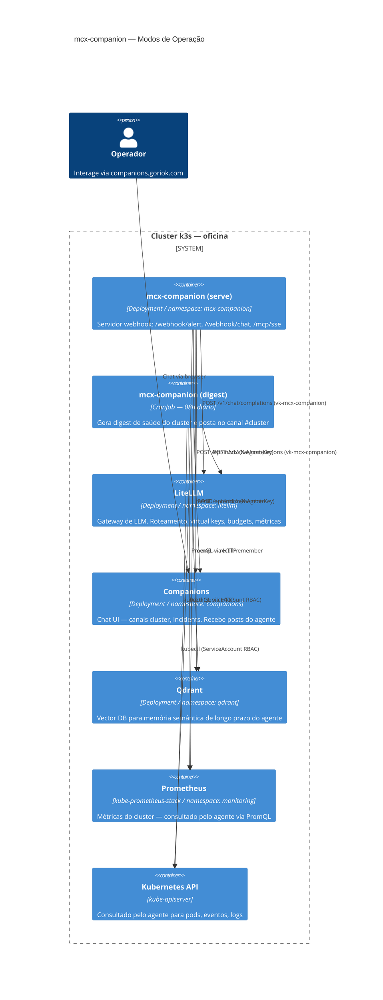

# Agents — mcx-companion

Documentação dos agentes autônomos que operam no cluster **oficina**.

---

## Visão Geral

O `mcx-companion` é um agente SRE autônomo que monitora e responde a eventos do cluster k3s. Roda como Deployment (webhook server) e CronJob (digest diário), usando LiteLLM como gateway para DeepSeek.



---

## Modos de Operação

### 1. Digest Diário (`mcx-companion digest`)

**Trigger:** CronJob `0 8 * * *` (08h00 diário)

**Fluxo:**
1. Coleta estado do cluster: `cluster_status`, `cluster_metrics_summary`, `recent_events`
2. LLM gera resumo estruturado (saúde, métricas, eventos, veredicto)
3. Posta no canal `cluster` via `companions /api/inbox`

**Output:** Markdown com emojis de status, máx 400 palavras.

---

### 2. Investigação de Alertas (`mcx-companion react`)

**Trigger:** `POST /webhook/alert` — chamado pelo Alertmanager (quando ativado)

**Fluxo:**
1. Recebe payload do Alertmanager (`ALERT_PAYLOAD` env)
2. Usa tools (logs, eventos, métricas) para investigar root cause
3. Posta diagnóstico no canal `incidents` com causa provável e ação recomendada
4. **Nunca executa mutações** — ações destrutivas são listadas como "requires human approval"

**Nota:** Alertmanager está desabilitado no `values.yaml` (`alertmanager.enabled: false`). Para ativar, setar `true` e configurar `alertmanagerConfig` apontando para `http://mcx-companion.mcx-companion.svc.cluster.local/webhook/alert`.

---

### 3. Chat Interativo (`mcx-companion serve` — `/webhook/chat`)

**Trigger:** Mensagem humana no canal do Companions (via `POST /webhook/chat`)

**Fluxo:**
1. Companions chama o webhook ao receber mensagem de usuário
2. Agente busca histórico do canal (últimas 20 mensagens)
3. Injeta memória semântica relevante (mem0 + Qdrant)
4. LLM responde com contexto do cluster atual (usa tools se necessário)
5. Posta resposta de volta no canal

---

### 4. MCP Server (`/mcp/sse`)

Expõe as tools do agente (`cluster_status`, `pod_logs`, `recent_events`, `cluster_metrics_summary`, `prometheus_query`) via protocolo MCP sobre SSE.

Endpoint: `https://mcx-companion.goriok.com/mcp/sse`

---

## Tools Disponíveis

| Tool | Descrição |
|------|-----------|
| `cluster_status` | Nós e pods não-running em todos os namespaces |
| `pod_logs` | Logs recentes de pods por label `app` e namespace |
| `recent_events` | Eventos Warning do cluster ou namespace específico |
| `cluster_metrics_summary` | CPU, memória, CrashLoopBackOff, jobs falhados (Prometheus) |
| `prometheus_query` | PromQL arbitrário instant query |

---

## Virtual Key LiteLLM

A key `vk-mcx-companion` tem os seguintes limites:

| Parâmetro | Valor |
|-----------|-------|
| Budget | $1/mês |
| RPM | 10 req/min |
| TPM | 100k tokens/min |
| Modelos | `deepseek-v4-flash` |

Gerenciar via: `mcx litellm budget show` / `mcx litellm budget edit`

---

## RBAC

O ServiceAccount `mcx-companion` tem `ClusterRole` read-only:

- `pods`, `nodes`, `services`, `endpoints`, `events`, `namespaces` — get, list, watch
- `pods/log` — get
- `deployments`, `replicasets`, `daemonsets`, `statefulsets` — get, list, watch
- `jobs`, `cronjobs` — get, list, watch

Sem permissões de escrita — o agente é observador, não executor.

---

## Memória

O agente usa [mem0](https://github.com/mem0ai/mem0) com Qdrant como vector store para memória semântica de longo prazo por canal (`memory_user = "channel:<canal>"`).

- **recall:** injeta memórias relevantes no system prompt antes de cada resposta
- **remember:** persiste o par (pergunta, resposta) após cada interação

Qdrant roda em `k8s/apps/qdrant` (sem ingress — acesso apenas interno via `qdrant.qdrant.svc.cluster.local:6333`).

---

## Manifests

```
k8s/apps/mcx-companion/
├── namespace.yaml
├── rbac.yaml              ← ServiceAccount + ClusterRole + ClusterRoleBinding
├── deployment.yaml        ← mcx-companion serve (port 8080)
├── service.yaml           ← ClusterIP :80 → :8080
├── ingress.yaml           ← mcx-companion.goriok.com
└── cronjob-digest.yaml    ← 0 8 * * * mcx-companion digest
```

Secret necessário no cluster:

```bash
kubectl create secret generic mcx-companion-secret \
  --namespace mcx-companion \
  --from-literal=LITELLM_API_KEY="sk-..." \
  --from-literal=COMPANIONS_AGENT_KEY="..." \
  --from-literal=COMPANIONS_URL="http://companions.companions.svc.cluster.local" \
  --from-literal=LITELLM_BASE_URL="http://litellm.litellm.svc.cluster.local/v1" \
  --from-literal=MODEL="deepseek-v4-flash"
```

---

# Agents — hyle (`family-hyle`)

Agent de conversa pelo Telegram para a família. Tenant `family`, namespace `family-hyle`, manifests em `k8s/apps/family-hyle/`.

O bot faz polling: só tem tráfego de saída (Telegram e Anthropic), então não há Service nem Ingress. O Telegram entrega as atualizações de um token a um único consumidor, por isso o Deployment tem `replicas: 1` e `strategy: Recreate`. Mais agents entram como apps separados, cada um com o seu token.

As conversas ficam em `/data/sessions` num PVC (`family-hyle-data`, 1Gi), com permissão `0600`. A chave do modelo é a da Anthropic (`CL_API_KEY`), sem passar pelo LiteLLM.

## Primeira vez (uma só vez)

Namespace e secrets. Os valores vêm de variáveis de ambiente do terminal, para não ficarem no histórico do shell.

```bash
kubectl apply -f k8s/apps/family-hyle/namespace.yaml   # namespace com as labels do tenant

kubectl create secret docker-registry mgc-registry-credentials \
  --docker-server=container-registry.br-se1.magalu.cloud \
  --docker-username="$MGC_USER" \
  --docker-password="$MGC_TOKEN" \
  --namespace family-hyle

kubectl create secret generic family-hyle-secret \
  --namespace family-hyle \
  --from-literal=CL_API_KEY="$CL_API_KEY" \
  --from-literal=TELEGRAM_BOT_TOKEN="$TELEGRAM_BOT_TOKEN" \
  --from-literal=TELEGRAM_ALLOWED_IDS="$TELEGRAM_ALLOWED_IDS"
```

`TELEGRAM_ALLOWED_IDS` é uma lista de ids numéricos separados por vírgula. Com a lista vazia o bot ignora todos e só registra os ids no log. Para mudar a lista: recriar o secret e rodar `mcx deploy restart family-hyle`.

## Atualizar o agent

Um comando:

```bash
mcx deploy all family-hyle --yes
```

Ele constrói a imagem para o `platform` do `mcx.toml` (`linux/amd64`, a arquitetura dos nós, mesmo num Mac Apple Silicon), envia ao registry, aplica os manifests e, como o app tem `restart = true`, reinicia o Deployment e espera o rollout terminar. O reinício é necessário porque a imagem usa a tag `:latest`: aplicar o mesmo manifesto não troca o pod sozinho.

Depois:

```bash
kubectl diff -k k8s/apps/family-hyle   # antes de aplicar, para revisar mudanças nos manifestos
mcx logs app family-hyle               # esperar "hyle telegram: @<bot>" no log
mcx deploy restart family-hyle         # só reinicia, por exemplo depois de recriar o secret
```

Antes do primeiro deploy, pare qualquer outro processo que use o mesmo token, local ou em outra máquina: só um pode fazer polling.

## Backup

Há duas camadas.

**Dentro do volume (já ativa).** O próprio app mantém cópias consistentes do banco (`VACUUM INTO`) em `/data/backups`:

- Pelo menos uma por dia, checada de hora em hora, com retenção das 14 mais recentes (`HYLE_BACKUPS_KEEP`).
- Uma cópia extra, rotulada `pre-vN-to-vM`, antes de qualquer migração de esquema. Se a cópia falhar, o app não migra e não sobe.
- No Telegram, `/backup` mostra quantas cópias existem e `/backup agora` cria uma na hora.

Protege contra erro de migração, importação errada e corrupção. **Não protege se o volume ou o nó se perderem.**

**Fora do volume (CronJob `family-hyle-backup`, suspenso).** Roda `restic` para o R2 todo dia às 03:30 UTC, com criptografia no cliente, e copia `/data/backups` e `/data/sessions` (as conversas). O job lê o volume em modo somente leitura e é forçado a rodar no mesmo nó do pod do app, porque o volume é `local-path`. Ele só funciona depois de criar o secret:

```bash
kubectl -n family-hyle create secret generic backup-credentials \
  --from-literal=RESTIC_REPOSITORY="s3:https://<conta>.r2.cloudflarestorage.com/<bucket>/family/hyle" \
  --from-literal=RESTIC_PASSWORD="<senha do restic>" \
  --from-literal=AWS_ACCESS_KEY_ID="<id>" \
  --from-literal=AWS_SECRET_ACCESS_KEY="<segredo>" \
  --from-literal=HEALTHCHECK_URL="http://hc-ping.com/<uuid>"   # opcional

kubectl -n family-hyle patch cronjob family-hyle-backup -p '{"spec":{"suspend":false}}'
kubectl -n family-hyle create job --from=cronjob/family-hyle-backup family-hyle-backup-teste
kubectl -n family-hyle logs -f job/family-hyle-backup-teste
```

Guarde a senha do restic fora do cluster: sem ela não há restauração. Use uma URL `http://` no Healthchecks, porque o `wget` da imagem não faz HTTPS.

### Restaurar

- **De uma cópia do volume:** pare o app (`kubectl -n family-hyle scale deploy/family-hyle --replicas=0`), copie `/data/backups/<cópia>.db` sobre `/data/finance.db` (apague `finance.db-wal` e `finance.db-shm`), mantenha o dono `1000` e o modo `600`, e suba de novo.
- **Do R2:** em qualquer máquina com `restic` e as credenciais, `restic restore latest --tag family-hyle --target /tmp/restore`, e depois use a cópia mais recente de `backups/` como acima.

## Limitações conhecidas

- Sem probes: não há porta HTTP, então um travamento do polling só é detectado quando o processo cai.
- O backup fora do volume só passa a existir depois que o secret `backup-credentials` for criado e o CronJob for reativado (seção Backup). Até lá, as cópias ficam no mesmo volume do banco.
- O estado está em arquivos num PVC, enquanto a plataforma prefere apps sem estado sobre o Postgres compartilhado. O armazenamento é uma interface (`TurnStore`) e pode ganhar uma implementação em Postgres.
- O limite de gasto é em tokens por hora por pessoa (`HYLE_HOURLY_TOKENS`, hoje 200000), não em reais.
